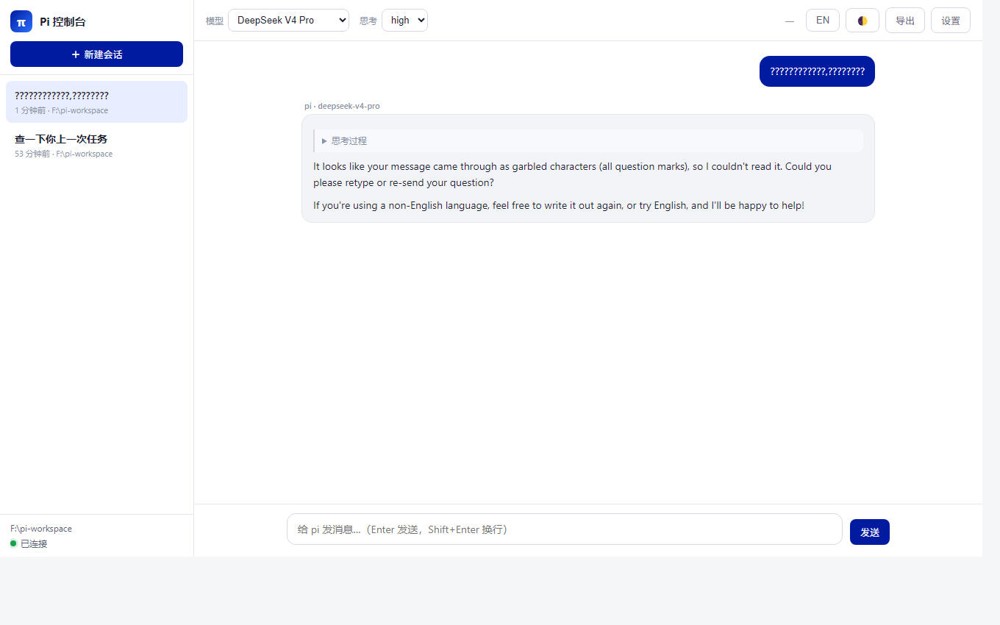

<div align="center">

# π Pi Web Console

**A WorkBuddy-style web interface for driving the [pi](https://pi.dev) coding agent.**

*Zero dependencies · Streaming · Session management · Model switching · Tool-call visualization*

</div>

> A WorkBuddy-style web console that drives the [pi](https://github.com/earendil-works/pi) coding agent over its official RPC mode. Zero third-party dependencies, streaming chat, session management, model switching, and live tool-call visualization.

中文文档：[README.md](./README.md)

---

## What is this

[pi](https://pi.dev) is a minimal, extensible coding agent that normally lives in your terminal. This project wraps it in a **web chat interface**, so you can use it in the browser just like WorkBuddy / CodeBuddy:

- Stream pi's replies, reasoning, and tool calls (read files, write files, run commands …) in real time
- Manage multiple sessions — create, switch, delete, export to HTML
- Switch models and thinking levels, abort running tasks

It drives pi through pi's official **RPC mode** (`pi --mode rpc`): the backend runs pi as a Node child process and relays commands and streaming events between the browser and pi.

## Screenshot



## Features

- ⚡ **Streaming chat** with Markdown rendering and code highlighting
- 🧠 **Thinking/reasoning** shown in a collapsible block
- 🛠 **Tool-call visualization** — read/write files, shell commands, etc., rendered as live cards with args and results
- 💬 **Session management** — create / switch / delete sessions, persistent history (JSONL)
- 🎛 **Model + thinking level switching** (deepseek / anthropic / openai …)
- ⏹ **Stop / abort** a running task at any time
- 📦 **Export HTML** for the current session
- 🌓 **Dark mode** (`Ctrl+Shift+D` or the top-right button)
- 🔌 **Zero third-party dependencies** — uses only Node built-ins, no `npm install` required

## Prerequisites

1. [pi](https://pi.dev) installed (installer or npm global) and signed in to a model provider:
   ```bash
   pi --list-models   # should list at least one model
   ```
2. **Node.js ≥ 22.19.0** (required by pi itself)

## Quick start

### Method 1: run directly (no dependency install)

```bash
# clone or download this repo, then
cd pi-web-console
node server.mjs
```

Open http://localhost:8000 in your browser.

On Windows you can double-click `start.bat`; on macOS/Linux run `./start.sh`.

### Method 2: npm

```bash
npm install        # this repo has no runtime dependencies, this step is optional
npm start          # equivalent to `node server.mjs`
```

On first run a `config.json` is generated automatically (see `config.example.json` for the template).

## Configuration

`config.json` (auto-generated on first run):

| Field | Description | Default |
|---|---|---|
| `port` | Web server port | `8000` |
| `workspace` | Working directory for pi (empty = `pi-workspace` under your home) | `<home>/pi-workspace` |
| `sessionDir` | Session file directory | `<repo>/sessions` |
| `approve` | Trust project-local files (AGENTS.md etc., equivalent to `pi --approve`) | `true` |
| `piInstallRoot` | pi installer root (usually auto-detected) | `<home>/.pi/agent/install` |
| `piCliPath` | **Optional**: explicit path to pi's `cli.js` (highest priority) | empty |
| `nodePath` | **Optional**: explicit path to the node executable | empty |

> The working directory can also be changed from the in-app **Settings** panel; pi restarts automatically.
> If pi cannot be auto-detected, set `piCliPath` in `config.json`.

## Project structure

```
pi-web-console/
├── server.mjs              # Backend: HTTP + SSE + pi RPC child-process management (zero deps)
├── start.bat               # Windows one-click launcher
├── start.sh                # macOS / Linux one-click launcher
├── package.json            # npm metadata and start script
├── config.example.json     # Configuration template
├── LICENSE                 # MIT
└── public/
    ├── index.html          # UI structure
    ├── style.css           # UI styles (incl. dark mode)
    └── app.js              # Frontend logic (Markdown renderer, event handling)
```

## How it works

```
Browser (UI)
   ↕ SSE event stream + HTTP commands
server.mjs (Node built-ins, zero deps)
   ↕ stdin/stdout JSONL (pi RPC protocol)
pi --mode rpc (coding agent child process)
```

The backend follows pi's official [RPC mode](https://github.com/earendil-works/pi) protocol:

- Forwards the browser's `prompt / abort / new_session / switch_session / set_model / export_html …` to pi;
- Pushes pi's streaming events (`text_delta` / `thinking_delta` / `tool_execution_*` / `agent_settled`) to the browser over **SSE** for live rendering.

See `ALLOWED_COMMANDS` in [server.mjs](./server.mjs) for the supported commands.

## FAQ

**Q: The page shows "disconnected"?**
First make sure pi runs standalone: `pi --list-models`. If that works, check `piInstallRoot` / `piCliPath` in `config.json`, or inspect errors in the Settings panel.

**Q: Do I need Docker or npm packages?**
No. Zero third-party dependencies; it only requires your local Node and pi.

**Q: How do I change the default model?**
Use the dropdown in the top bar, or list models with `pi --list-models`.

## Contributing

Issues and PRs are welcome. When changing `server.mjs`, self-test locally:

```bash
node server.mjs
# in another terminal
curl http://localhost:8000/api/state
```

## License

[MIT](./LICENSE)
